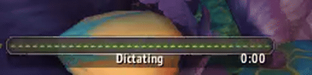

# TypeWhisper for World of Warcraft

Dictate into the World of Warcraft chat with [TypeWhisper](https://www.typewhisper.com). The chat opens by itself, long text goes out as several messages, and a cast bar in the game's own style shows what TypeWhisper is doing.

Works in all World of Warcraft versions: Retail, Classic, Classic Era and Forever.

[Watch the video on YouTube](https://www.youtube.com/watch?v=hfFLMD8U0i0): the settings page, placing the cast bar and a test run.

## Install

TypeWhisper for Windows installs the add-on for you: open **Settings › Advanced › Integrations**, turn on **World of Warcraft** and click **Install add-on**. TypeWhisper finds the game through Battle.net and copies the add-on into every installed version. If the game is running, type `/reload`.

For a manual install, download `TypeWhisper-<version>.zip` from the [releases](https://github.com/TypeWhisper/typewhisper-wow/releases) and extract it into `World of Warcraft\<version>\Interface\AddOns\`.

## How it works

Add-ons cannot talk to TypeWhisper: they have no network, file or clipboard access. TypeWhisper only presses keys, and the add-on gives four of them a meaning:

| Chord | Meaning |
| --- | --- |
| Ctrl+Shift+F11 | Open the chat. Bound to the game's own *Open Chat* command. |
| Ctrl+Shift+F8 | Recording started. |
| Ctrl+Shift+F9 | Recording ended, TypeWhisper is transcribing. |
| Ctrl+Shift+F10 | The dictation was canceled or failed. |

Ctrl+Shift+F11 opens a closed chat. An open chat ignores it, so its text and focus stay as they are. Pressing Enter instead would send or close an open chat.

The other three chords drive the cast bar:

- **Recording:** a green waveform, like a channeled spell. No audio reaches the game, so the waveform is drawn, not measured.
- **Transcribing:** the bar fills like a spell cast.
- **Done:** the bar completes when TypeWhisper opens the chat for the text, or when the text arrives in a chat that was already open.
- **Canceled or failed:** the bar turns red, like an interrupted cast.

While the chat input has focus, it takes every key and key bindings do not fire. The add-on then listens on the chat input for its three chords. It only listens: the chat's own handlers run first and unchanged, and the add-on never writes to the chat. Sending stays with Blizzard's own code, so it also works during encounters. The bindings are override bindings: they sit on top of your own key bindings and are never saved with them.

## Settings

Everything about dictating in the game is set on the add-on's page in **Options › AddOns › TypeWhisper**. Type `/tw`, or on Retail and Forever use the add-on menu on the minimap.

- **Send messages automatically:** Enter sends each message. Turn it off to check the text in the chat before you send it.
- **Show the cast bar while you dictate:** turn it off to see TypeWhisper's own indicator instead.
- **Translate my messages into:** TypeWhisper translates each dictation with the default LLM of its workflows. The page names that LLM.

TypeWhisper reads these settings from the add-on's saved variables, which the game writes when you type `/reload` or log out. After a change, the page offers a **Reload now** button. The other way round, TypeWhisper writes `Status.lua` into the add-on folder to name the translating LLM; the game loads it on the next `/reload`.

To answer a whisper, press the game's Reply key, then dictate.

## Commands

- `/tw` or `/typewhisper`: reports whether the bindings are active and opens the settings page.
- `/tw test`: plays a dictation on the cast bar.
- `/tw move`: unlocks the bar so you can drag it; type it again to lock it.
- `/tw scale 120`: sets the bar size, from 50 to 200 percent.
- `/tw reset`: puts the bar back in its default place.

The add-on keeps the last 40 signals of a session in its saved variables for troubleshooting. It records only the three signal keys and its own state changes, never typed text.

## Files

- `TypeWhisper.toc`: supported game versions, icon and saved variables
- `Status.lua`: written by TypeWhisper; ships empty
- `TypeWhisper.lua`: the bindings, the cast bar and the settings page
- `Icon.tga`: the TypeWhisper logo for the add-on list, 64×64 pixels (the game loads TGA or BLP, not PNG)

## Releases

Bump `## Version` in `TypeWhisper.toc`, then push a tag `v<version>`. The release workflow packages the add-on and attaches the ZIP to a GitHub release. TypeWhisper for Windows ships a copy of each release and offers it as an update when the version changes.

## License

[MIT](LICENSE)
